# RiskLens

**Film a room. See what could fall in an earthquake, with the exact frame and what to do next.**

- **Demo video (2:32):** https://youtu.be/2tA6bLuztSk
- **Live product:** https://selcuksntrk--risklens-web.us-east.modal.run
- **Hackathon:** Meta Global AI Developer Hackathon · Indie Developer · theme: **Build for Your World**

RiskLens turns a one-minute phone video of a room into a list of things that could fall, tip over or block your way out in an earthquake. Each finding shows the frame and box it is based on, says what the video can't show, and links next steps to FEMA E-74 guidance.

It is a visual check, not a building inspection. It says nothing about structural safety, does not predict earthquakes, and does not certify an installation.

## Why this exists

I live in Istanbul, where most of us know an earthquake is a question of when. An engineer can't visit every flat, but a wardrobe that can tip, a shelf above a child's bed or boxes narrowing the way to the door are things a family can deal with today, if someone points them out.

The wider problem is documented: in a study of New Zealand commercial buildings during the 2010–2014 earthquakes, 556 of 947 injuries were attributed to non-structural damage ([Yeow et al., 2020](https://doi.org/10.1177/8755293019900775)). That sample is not homes, but the hazards are the kind RiskLens looks for.

RiskLens is for people preparing the rooms they live in. It needs a phone and about a minute, with no account and no expert on site.

## Try it in a minute

Open the [live product](https://selcuksntrk--risklens-web.us-east.modal.run). The first visit after an idle period can take 10–15 seconds while the server starts.

1. Open one of the four examples on the home page: the author's real flat in Istanbul, or one of three test rooms made with Muse Image. Each report opens without new model calls.
2. Open a finding to see its frame, what is still unknown, the FEMA-linked steps and an AI-made picture of a possible fix.
3. Choose **Replay the analysis** to watch a recorded run, or **Run it again live** to start a new one on Meta's models. A live run usually takes 2–3 minutes (100–273 s in recorded runs).
4. Or film or upload your own room. Your scan stays private to your browser.

## How it works

Each model does one job and hands its result to the next. Code checks the result at each gate.

```mermaid
flowchart LR
  V[Phone video] --> F[ffmpeg: keyframes and proxy]
  F --> P[Muse Spark 1.3<br/>planner: what to track]
  P --> S[SAM 3.1<br/>tracks objects through the video]
  S --> M[Boxed frames]
  M --> U[Muse Spark 1.3<br/>surveyor: visible vs unknown]
  U --> X[Muse Spark 1.3 + FEMA E-74 lookup<br/>source-checked next steps]
  X --> R[Report: frame, unknowns, steps]
  R -. on request .-> I[Muse Image 1.0<br/>labelled picture of a fix]
  R -. film again .-> C[SHA-256 check, then SAM 3.1 + Muse Spark 1.3<br/>same object, visible change]
  T[Scene description with planted hazards] --> G[Muse Image 1.0<br/>six anchored views]
  G --> Q[Muse Spark 1.3<br/>QA gate per view]
  Q --> W[Test-room walkthrough video]
  W -. public example with answer key .-> V
```



| Step | Meta model | What it does |
|---|---|---|
| Plan | Muse Spark 1.3 | Studies 6–12 still frames and decides which objects matter in this kind of room |
| Track | SAM 3.1 | Follows those objects through the video, so a finding points to a real box on a real frame |
| Survey | Muse Spark 1.3 | Reviews the boxed frames and keeps what it could see apart from what it couldn't, such as a hidden wall fixing |
| Next steps | Muse Spark 1.3 + FEMA E-74 tool | Looks up FEMA sections and writes steps that cite them. A step with no verified source is withheld |
| Picture a fix | Muse Image 1.0 | Edits the user's frame to show a possible fix, always labelled as AI-made and never treated as proof |
| Film again | SAM 3.1 + Muse Spark 1.3 | Compares a new video with the first, requiring the same object and a visible change. An identical file is caught by a SHA-256 check before any model runs |
| Voice note | Muse Voice Transcribe 1.0 | Turns an optional spoken note about the room into text |
| Test rooms | Muse Image 1.0 + Muse Spark 1.3 | Builds the test set: six views of each planned room, each checked by Spark before use (18 of 18 passed, 2 on a second attempt) |

## Evaluation

| Check | Result |
|---|---|
| Three test rooms with hazards planted and written down in advance | 5/5, 4/4 and 4/5 found (13 of 14). It missed boxes and a shoe cabinet narrowing the path to the front door. Control items placed to test false alarms were not flagged. One run per room, matched by hand |
| Five Hypersim scenes, Spark alone vs full pipeline, demo repeats and negative controls | 16 attempts, 0 failures, $2.08, 0 false confirmations on 4 negative controls. [Results](docs/EVALUATION.md) |
| Author's real home | Demonstration, not an evaluation. A recorded run: complete, 3 findings, 100 s, $0.275. [Quality notes](docs/QUALITY_NOTES.md) record what went wrong in earlier runs |
| Automated tests | 73 backend and 14 frontend tests, with mocked model APIs |

These are test scenes and one real home, so **no accuracy on real homes is claimed**. Validation on real before-and-after fixes has not been done.

## Engineering

- **Evidence you can check:** findings link to a tracked object, frame and box. "Observed" and "needs checking" are separate states, and a technical failure can't turn into a "low risk" result.
- **Enforced checks:** next steps without a verified source are blocked in the interface and the endpoint. Findings can't be closed by an identical file, an untracked object or uncertain identity.
- **Reliability:** idempotent uploads, a bounded job queue (one active, two queued), polling when live progress drops, and interrupted jobs that never silently restart paid calls.
- **Cost control:** each model call reserves budget first. There is a $15 daily model cap and daily scan limits per network. A run costs about $0.30.
- **Privacy:** scans belong to a random browser session, ownership is checked on every private route, videos are deleted after 7 days and reports after 30. Public examples come from a hash-checked list, so a private scan can't become public by its ID. Videos are processed by Meta's API, and deletion is requested after use.

Stack: React/TypeScript, FastAPI, ffmpeg and the Meta Model API, on one Modal container with a persistent volume.

## Limits

- It only sees what the video shows, and can miss objects or relationships. Hidden fixings are reported as unknown.
- Repeated runs can return somewhat different findings.
- FEMA-linked steps document what the model read. They are not reviewed by an engineer or endorsed by FEMA.
- A visible change does not prove a fix is adequate.
- It has been tested in emulated phone viewports. Physical phones, including iPhone/Safari, have not been fully tested.

## What's next

A volunteer pilot in real homes, with expert review of findings, to test whether people act on them ([pilot protocol](docs/PILOT.md)).

## Run it locally

Requirements: Python 3.11+, Node 22+, ffmpeg/ffprobe and uv. Copy `.env.example` to `.env` and set `MODEL_API_KEY`. Keys stay server-side.

```sh
cd backend
uv sync --frozen
cd ../frontend
npm ci
cd ..
python3 scripts/build_release.py
cd backend
uv run --env-file ../.env uvicorn app.main:app --port 8000
```

Open http://localhost:8000. Phone camera access requires HTTPS; see `scripts/phone.sh`.

The public examples are not in Git, so a fresh clone starts without them. `scripts/generate_scenes.py`, `scripts/render_walkthrough.py` and `scripts/package_example.py` rebuild the test rooms, which spends model budget.

```sh
# Tests use temporary storage and mocked model APIs; no paid requests.
cd backend
uv run --group dev pytest -q
cd ../frontend
npm test
npm run lint
npm run build
```

Command-line scan:

```sh
cd backend
uv run --env-file ../.env python -m app.cli scan /path/to/room.mp4 --narration "Bedroom; attachment conditions unknown"
uv run --env-file ../.env python -m app.cli verify SCAN_ID /path/to/refilmed.mp4 --hazard-id h1
```

## Repository map

| Path | Contents |
|---|---|
| `backend/app/` | API, pipeline, model agents, guards, FEMA E-74 knowledge |
| `frontend/src/` | Mobile-first web app |
| `eval/` | Synthetic regression results and protocol |
| `scripts/` | Test-room generator, release tools, visual QA, demo video tools |
| `deploy/` | Modal deployment |
| `docs/` | [Status](docs/STATUS.md), [evaluation](docs/EVALUATION.md), [acceptance tests](docs/ACCEPTANCE.md), [release runbook](docs/RELEASE.md), [judge answers](docs/submission/JUDGE-QA.md) |

## Built during the hackathon

Everything in `backend/`, `frontend/src/`, `deploy/`, `eval/` and `scripts/` was written during the event (Oct 26 – Nov 4, 2026). The commit history records it.

- Planner → SAM 3.1 tracking → surveyor pipeline, with exact-frame evidence and separate observed and needs-checking states.
- FEMA E-74 lookup tool and source-checked next steps.
- Re-filming comparison with SHA-256 same-file check, same-object and visible-change requirements, and attempt history.
- Video ingestion, proxy encoding and live progress.
- Browser-session ownership, deletion, retention, idempotent uploads, bounded queue, per-call budget reservations, Modal deployment and content-derived release IDs.
- Test-room generator with Muse Spark QA gate, walkthrough renderer, hash-checked example registry and recorded-run replay.
- Mobile-first, plain-language interface with one finding per screen.
- Synthetic regression runner, headless-Chrome visual QA, and the demo video tools (`scripts/record_phone.py`, `scripts/render_sam_hero.py`, `scripts/compose_demo.py`).

## Third-party material

- The SAM request grammar follows Meta's Model Cookbook (MIT, © Meta Platforms, Inc.).
- The frontend started from the Vite React/TypeScript template.
- Dependencies include React/Vite (MIT), openai (Apache-2.0), Pillow (MIT-CMU), FastAPI (MIT), uvicorn/websockets (BSD) and python-multipart (Apache-2.0). ffmpeg is an external program with its own LGPL/GPL licensing.
- The demo video's titles and captions use Archivo and IBM Plex Mono (SIL OFL). Neither ships with the app. Its voice was cleaned with nara_wpe (MIT).
- FEMA source excerpts, Hypersim evaluation assets and the sample videos have separate notices in [DATA_LICENSES.md](DATA_LICENSES.md).

Application code: MIT, see [LICENSE](LICENSE). Hypersim-derived assets are CC BY-SA 3.0 and are not relicensed under the application license.
